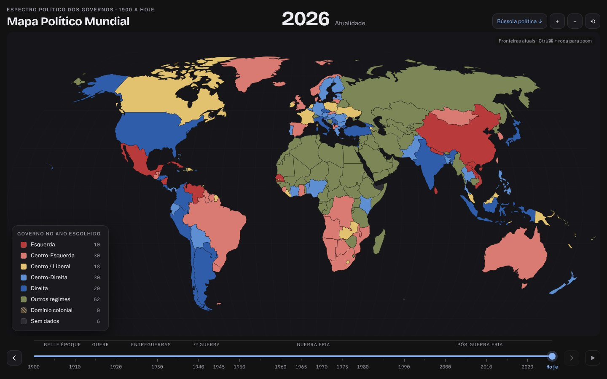
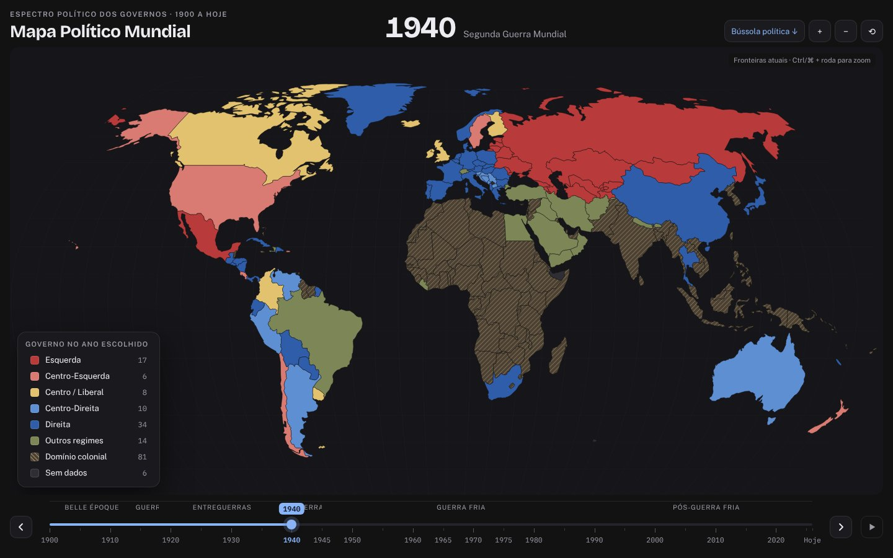
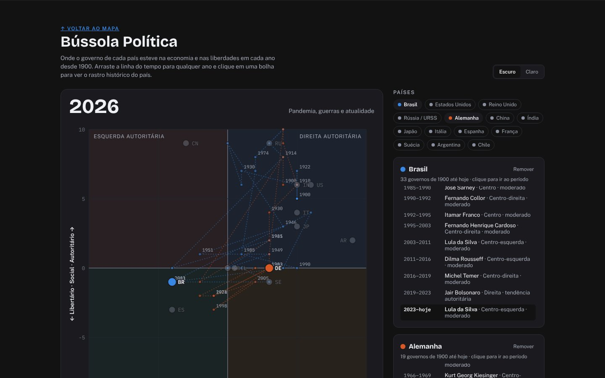
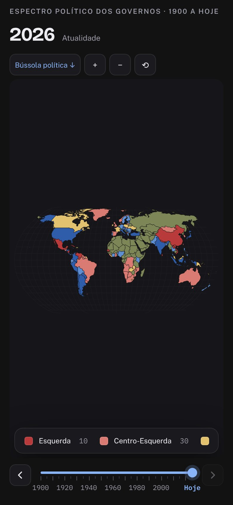

# Spectrum of the World — Mapa Político Mundial

An interactive world map of where each country's government sat on the political spectrum, from 1900 to today, with a political compass that traces each country's path over time. Interface in Portuguese.

**Live:** [espectrodomundo.vercel.app](https://espectrodomundo.vercel.app)



## What's inside

| Section | What it shows |
| --- | --- |
| **World map** | Every country colored by its government in the chosen year: left, centre-left, centre / liberal, centre-right, right, other regimes, colonial rule (hatched) or no data. A legend counts the countries in each group. |
| **Timeline** | Any year from 1900 to 2026, with era bands (Belle Époque, World Wars, Cold War, post-Cold War), step buttons and autoplay. Years between milestones show the last milestone and say which year the data comes from. |
| **Country details** | Hover or tap a country to see the leader and a one-line context for that year. Zoom with the buttons or Ctrl/⌘ + scroll. |
| **Bússola Política** | A political compass (economy left ↔ right, libertarian ↔ authoritarian) for 14 countries, with every government since 1900, each country's historical trail and a dark / light theme. |

The map colors 176 territories, with milestone data for 170 of them and government-by-government data for 43 major countries. Positions are interpretations of each government and simplify complex political systems; the file says so where the data is defined.

<table>
  <tr>
    <td></td>
    <td></td>
  </tr>
  <tr>
    <td colspan="2" align="center"></td>
  </tr>
</table>

## Built with

- **D3.js 7** (Natural Earth projection) and **TopoJSON** for the map, with the world geometry inlined
- **React 18** (UMD) with **Babel Standalone** for the political compass, so there is no build step
- **Tailwind CSS 3** (Play CDN) alongside hand-written CSS
- **Bricolage Grotesque**, **Public Sans** and **IBM Plex Mono** from Google Fonts
- Deployed on **Vercel**

## Project structure

```
.
├── index.html    # the whole site: markup, styles, data and scripts
├── favicon.svg   # spectrum colors in a circle
├── docs/         # screenshots used in this README
└── README.md
```

To add or correct data, edit the commented objects in `index.html`: `PAISES` (2026), `HIST` (milestone years), `EXTRA` (in-between years), `GOVERNOS` (year-by-year governments) and the compass `PAISES` list. Each one documents its format in the comment above it.

## Run locally

No install needed. Open `index.html` in a browser (it loads its libraries from public CDNs), or serve the folder:

```bash
npx serve .
```

## Contact

- [LinkedIn](https://www.linkedin.com/in/fl%C3%A1vio-veloso-a29b02254/)
- [X @flaviovlso](https://x.com/flaviovlso)
- [github.com/flaviohcveloso](https://github.com/flaviohcveloso)

---

© 2026 Flávio Veloso. All rights reserved.
